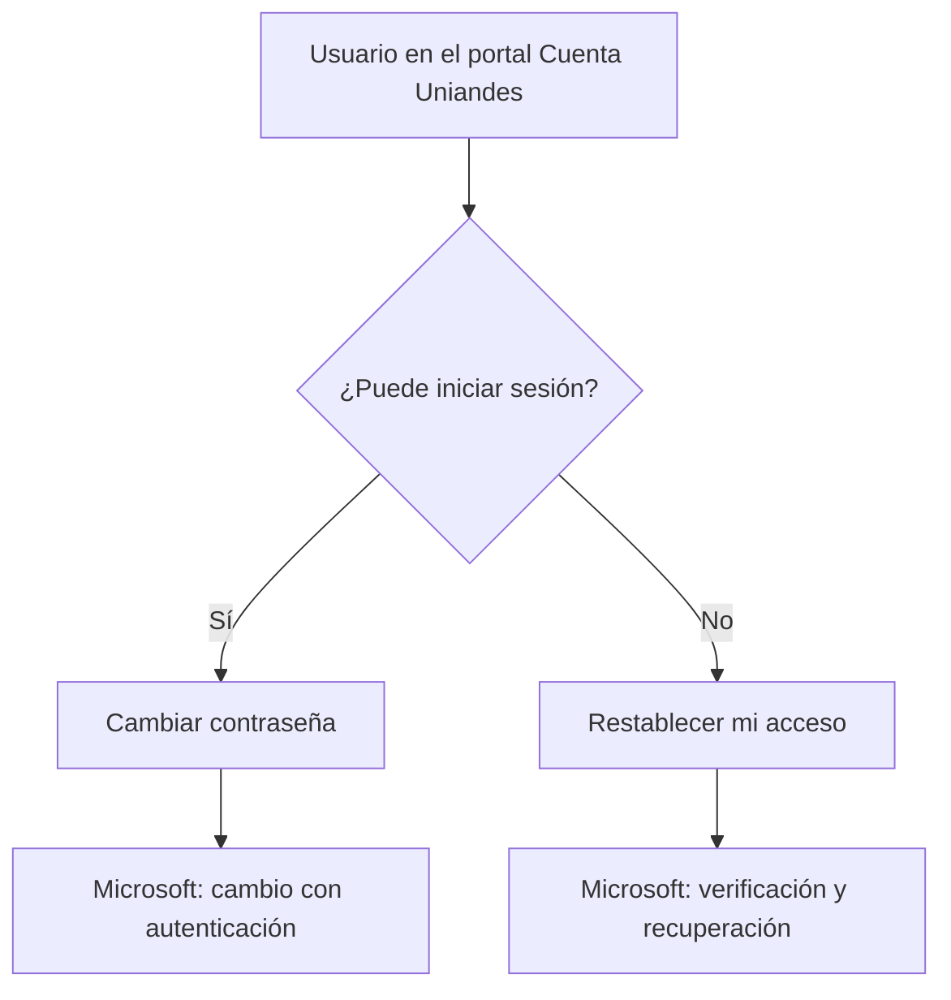
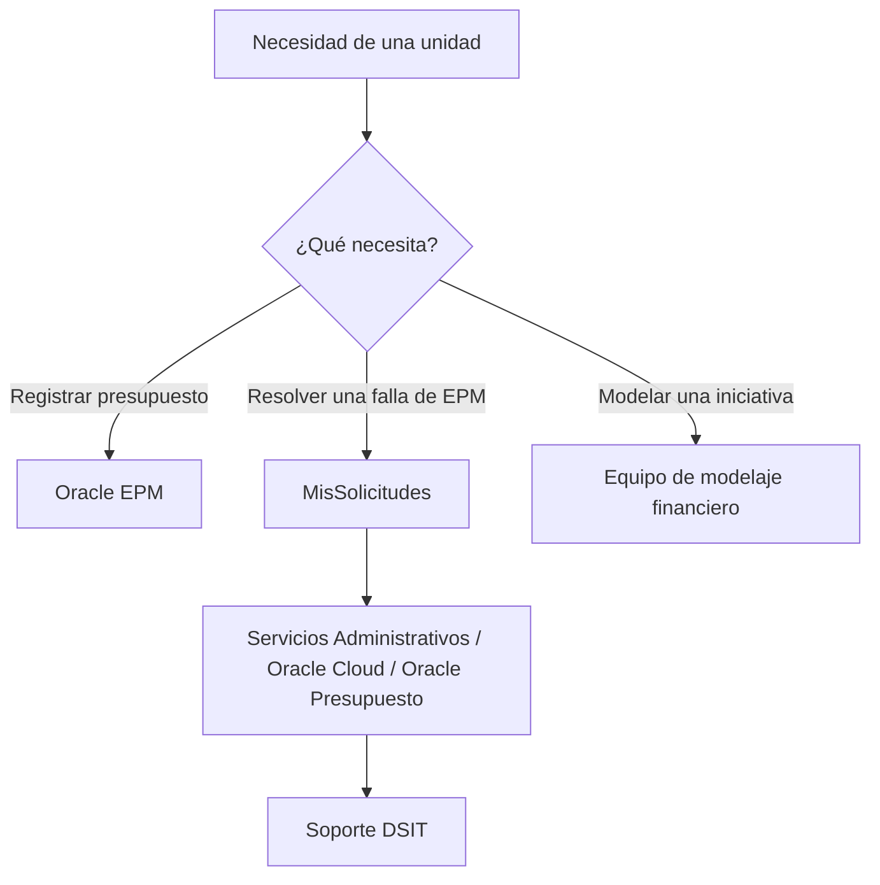

# MASS — Servicios institucionales de la Universidad de los Andes

Referencia técnico-funcional para desarrollo e integración · 18 de noviembre de 2026

1. [Introducción y alcance](#1-introducción-y-alcance)
2. [Panorama general de servicios institucionales](#2-panorama-general-de-servicios-institucionales)
3. [Herramientas y sistemas tecnológicos](#3-herramientas-y-sistemas-tecnológicos)
4. [Arquitectura e integraciones](#4-arquitectura-e-integraciones)
5. [Canales de atención y flujos funcionales](#5-canales-de-atención-y-flujos-funcionales)
6. [Áreas responsables](#6-áreas-responsables)
7. [Análisis de criticidad institucional](#7-análisis-de-criticidad-institucional)
8. [Matriz de relaciones y trazabilidad](#8-matriz-de-relaciones-y-trazabilidad)
9. [Hallazgos y vacíos documentales](#9-hallazgos-y-vacíos-documentales)

## 1. Introducción y alcance

MASS documenta cómo acceden estudiantes, profesores, administrativos y terceros a los servicios de la Universidad de los Andes. Para seguir un caso, identifique primero el servicio en el catálogo y luego consulte su canal, sistema y área en la matriz de trazabilidad. Un enlace describe navegación del usuario. Una transferencia de datos se indica expresamente cuando está documentada.

El **Programa de Desarrollo Integral (PDI) 2026–2030** articula modelos educativos, investigación, creación y emprendimiento, sostenibilidad financiera y transformación digital. En las páginas 41–49 plantea integrar procesos e información mediante el Sistema de Gestión de la Arquitectura Institucional (SGAI), ampliar el modelo único de atención, fortalecer competencias digitales y aprovechar analítica, IA y canales omnicanal. Estas metas dan contexto al modelo transversal de la Vicerrectoría Administrativa y Financiera (VAF).

El modelo de atención busca dar continuidad a la recepción, clasificación, gestión, respuesta y cierre de cada solicitud. El proyecto identifica **DISRUPTIA** como espacio de cocreación entre unidades y DSIT. Los componentes descritos por participantes del proyecto llevan la indicación **reportado** para distinguir su procedencia de las funciones verificadas en portales, formularios o guías.

## 2. Panorama general de servicios institucionales

El [portal Servicios Uniandes](https://servicios.uniandes.edu.co/) organiza la oferta en seis áreas de navegación. La responsabilidad sobre un trámite se indica por separado.

| Área | Oferta y destinatarios |
|---|---|
| [Vida Académica](https://servicios.uniandes.edu.co/vida-academica/) | Reglamentos, admisiones y Registro, calendario, matrículas, cartera, apoyo financiero y académico (Orión), consejería, convivencia y Decanatura. También remite a intercambios, innovación y emprendimiento, prácticas y oportunidades profesionales, Centro de Español, Bibliotecas y voluntariado. |
| [Vida en el Campus](https://servicios.uniandes.edu.co/vidacampus/) | Acceso y carnetización, deporte, casilleros, alimentación, tienda, salud, movilidad, objetos encontrados, servicios al aula, mantenimiento, vivienda, parqueaderos y Gerencia de Negocios Institucionales. La Universidad también publica el [protocolo MAAD](https://www.uniandes.edu.co/es/convivencia-y-transparencia). El acceso al campus contempla comunidad Uniandes, visitantes, contratistas y proveedores. |
| Tecnología | El portal distingue servicios para toda la comunidad (cuenta y A2P, conectividad, herramientas académicas y colaborativas, software, soporte, cómputo de investigación y seguridad) y oferta para profesores y administrativos (aplicaciones de gestión, CRM, telefonía, analítica y nube). Ver [Acceso y Conexión](https://tecnologia.uniandes.edu.co/conexion/), [Comunicaciones y Canales](https://tecnologia.uniandes.edu.co/comunicaciones/) e [Investigación y Creación](https://tecnologia.uniandes.edu.co/investigacion/). |
| [Eventos](https://servicios.uniandes.edu.co/eventos/) | Asesoría y producción para eventos presenciales y virtuales, agenda cultural, alimentación, aseo especial, seguridad y reserva de espacios. La ficha de reservas distingue salones, auditorios, áreas comunes, salas de exposición y escenarios como Centro Deportivo, CityU, Hacienda El Noviciado y Sede Caribe. |
| [Gestión Administrativa y Financiera](https://servicios.uniandes.edu.co/gestion-administrativa-y-financiera/) | Consultar el [catálogo de 14 servicios](#servicios-administrativos-y-financieros), que incluye el formulario de Recaudos de Servicios de Ingresos. |
| [Gestión Humana y Desarrollo Organizacional](https://ghdo.uniandes.edu.co/) | Atracción y promoción, contratación laboral y civil, nómina y certificados, gestión de extranjeros, seguridad social, formación, desarrollo, cultura, bienestar y asuntos laborales. |

### Servicios administrativos y financieros

Las fichas del [catálogo institucional](https://servicios.uniandes.edu.co/gestion-administrativa-y-financiera/) distinguen servicios de orientación, trámites y herramientas de autoservicio.

| Servicio | Necesidad, público y acceso |
|---|---|
| [Abastecimiento Estratégico](https://servicios.uniandes.edu.co/servicio-de-abastecimiento/) | Apoya a las unidades académicas y administrativas en negociación estratégica, gestión de proveedores, comercio internacional, seguros y creación de artículos. La ficha reúne catálogos, lineamientos, preguntas frecuentes y una sección de contacto. |
| [Activos Fijos](https://servicios.uniandes.edu.co/activos-fijos/) | Las unidades pueden solicitar el registro de activos y reportar cambios de responsable, ubicación, unidad o centro de costo, además de reintegros y reutilizaciones. La ficha enlaza la directriz y los formatos. Para reportar novedades, indica enviar el formato al correo del servicio con copia a la jefatura inmediata. |
| [Gestión Documental y Memoria Institucional](https://gestiondocumental.uniandes.edu.co/) | Reúne el modelo de gestión documental, las tablas de retención documental, recursos de apoyo, fondos y colecciones, información del sistema de calidad y un canal para donar archivos de posible valor histórico. |
| [Asesoría Contable e Informes de Ejecución Financiera](https://servicios.uniandes.edu.co/asesoria-contable/) | La mesa de atención cubre asesoría tributaria y contable, certificados, información financiera de proyectos, facturas de proveedores, creación y actualización de terceros, estados de cuenta y reconsideraciones de estudiantes. |
| [Compra de Bienes y Servicios](https://servicios.uniandes.edu.co/compras/) | Apoya adquisiciones, compras por catálogo, fondo rotatorio, tarjetas, pagos a proveedores y recepción. La ficha enlaza el Autoservicio de Compras en Oracle, registro de recepciones, devoluciones y garantías, catálogos y requisitos por categoría. |
| [Contratación](https://servicios.uniandes.edu.co/contratacion/) | Separa las rutas de contratación de personas naturales y jurídicas para prestación de servicios. Ofrece una herramienta de apoyo para identificar el trámite de formalización aplicable a una adquisición. |
| [Correspondencia y Mensajería Certificada](https://servicios.uniandes.edu.co/correspondencia-y-mensajeria-certificada/) | Recibe y distribuye correspondencia de unidades académicas y administrativas y coordina envíos urbanos, nacionales e internacionales. Publica recorridos y acuerdos de servicio. Recepción y mensajería atienden de lunes a viernes, 8:00 a. m. a 5:00 p. m., en Calle 19 n.º 1-21. El conmutador 601 339 4949 publica las extensiones 2094 (recepción), 2173 (mensajería) y 2191 (recorridos). |
| [Facturación](https://servicios.uniandes.edu.co/servicio-facturacion/) | Gestiona facturación electrónica para ventas a terceros y matrículas patrocinadas por empresas. Publica formularios e instructivos de factura comercial y nota crédito, además de un calendario de radicación. La facturación asociada a contratos o convenios de ingreso sigue la ruta del servicio de contratación de ingresos. |
| [Gestión Presupuestal](https://servicios.uniandes.edu.co/gestion-presupuestal/) | Apoya la planeación y el seguimiento presupuestal, los ajustes y el modelaje financiero de iniciativas de facultades y unidades. Enlaza Oracle EPM y recursos de facturación interna. Para asuntos técnicos indica MisSolicitudes → Servicios Administrativos → Oracle Cloud → Oracle Presupuesto. Para modelaje publica atención de lunes a viernes, 8:00 a. m. a 5:00 p. m. |
| [Viajes](https://servicios.uniandes.edu.co/servicio-de-viajes/) | Acompaña viajes institucionales académicos, administrativos y de investigación, entre otros. Atiende cotizaciones, compras, modificaciones, transporte, alojamiento, anticipos, reembolsos y auxilios a invitados y estudiantes. La ficha ofrece una aplicación y una vía por correo para legalizar gastos con sus soportes. |
| [Sistema de Pagos y Recaudos (SIRE)](https://servicios.uniandes.edu.co/sire/) | Estudiantes y aspirantes pueden pagar productos y servicios con o sin correo Uniandes. Profesores y empleados con rol habilitado pueden consultar recaudos y descargar reportes o administrar botones de pago según su rol. La ficha publica el 601 339 4949, ext. 1234, de lunes a viernes de 8:00 a. m. a 12:00 m. y de 1:00 a 5:00 p. m. |
| [Servicios de Ingresos](https://uniandes.my.site.com/s/servicios-cartera-ingresos) | Formulario de solicitudes del área de Recaudos para estudiantes y administrativos. Incluye certificados bancarios, validación y certificación de pagos, desaplicaciones, aplicación de facturas y legalización de matrículas, registros fuera de SIRE, correcciones de ingresos, enlaces de pago en moneda extranjera (Flywire), habilitación de eventos (Eventtia) y soporte y gestión de usuarios de la pasarela de pagos. |
| [Zona Proveedores](https://servicios.uniandes.edu.co/zona-proveedores/) | Orienta a proveedores y contratistas sobre registro, portal de proveedores, radicación de facturas y pólizas. Para solicitar el registro, el proveedor debe pedir el correo o enlace de autorregistro al funcionario que requiere la adquisición e identificarlo en el trámite. |
| [Seguridad y Salud en el Trabajo](https://servicios.uniandes.edu.co/seguridad-y-salud-en-el-trabajo/) | Incluye asesoría, capacitación y ergonomía, guías para reportar accidentes laborales y emergencias, autorreporte de condiciones de trabajo y lineamientos del SG-SST. Para asesorías publica Casa FE3, 601 339 4999, ext. 2590, de lunes a viernes de 7:00 a. m. a 5:00 p. m. |

### Servicios académicos y tecnológicos de consulta frecuente

- [Registro](https://www.uniandes.edu.co/es/registro) publica calendarios, cursos, exámenes, grados y solicitudes de certificados. Enlaza miBanner para la gestión del horario y ofrece citas virtuales.
- [Matrículas](https://matriculas.uniandes.edu.co/) dirige al estudiante al portal de pagos, confirmación de ingreso, reserva de cupo e historial. [Apoyo Financiero](https://apoyofinanciero.uniandes.edu.co/) orienta sobre becas y financiación.
- [Servicios al Aula](https://servicios.uniandes.edu.co/servicios-al-aula/) ofrece salas de cómputo, préstamo de dispositivos y apoyo audiovisual. [Reserva de espacios](https://servicios.uniandes.edu.co/reserva-de-espacios-para-eventos-y-exposiciones/) distingue los espacios reservables en línea de las sedes con contacto propio.
- [Mi Cuenta Uniandes](https://tecnologia.uniandes.edu.co/micuenta/) reúne orientación de acceso, contraseña y autenticación en dos pasos (A2P). Para investigación, la oferta tecnológica comprende clúster de alto desempeño y recursos de nube.

## 3. Herramientas y sistemas tecnológicos

| Componente | Función documentada y ámbito de uso |
|---|---|
| miBanner y Sistema de Conflicto de Horarios (SCH) | La inscripción regular de cursos se realiza en Banner. El SCH recibe casos como cruce de horario, cambio de sección y falta de cupo. |
| Oracle EPM y Autoservicio de Compras | EPM permite registrar el presupuesto de las unidades. El autoservicio de Oracle tramita adquisiciones según el mecanismo de compra. |
| SIRE | Permite pagar, crear botones de pago y consultar recaudos según el perfil. La ficha requiere aprobación del ordenador de la unidad para crear o modificar roles. Los reportes se descargan en Excel. |
| Bookeau | Canal de reserva publicado para salones, auditorios, áreas comunes y salas de exposición. Registro también enlaza una instancia de Bookeau para citas. |
| MisSolicitudes | Recibe solicitudes e incidentes tecnológicos. La ficha de Presupuesto identifica la categoría específica para Oracle Presupuesto. |
| SénecaBot y CuentaIA | SénecaBot se ofrece por WhatsApp en los canales de tecnología. CuentaIA, también denominado Cuenta en el proyecto, orienta sobre acceso institucional. |
| Plataformas reportadas en MASS | Inconcert centraliza correo y telefonía. Salesforce se identifica como CRM, Acquia para gestionar sitios web y Faro Uniandes en apoyo financiero. En atención inicial se reporta uso de Excel como base de conocimiento y de Power BI para consulta. Compras también publica una consulta de terceros en Power BI. |

## 4. Arquitectura e integraciones

La guía de CuentaIA *Flujo 2 – Restablecer y Cambio de Contraseña* (versión 5.4) distingue dos recorridos del usuario. El primero exige poder iniciar sesión. El segundo conduce a la verificación de identidad para recuperar el acceso. La guía incluye primer ingreso sin contraseña inicial, vencimiento y cambio por vulnerabilidad, y establece que el agente no solicita ni almacena contraseñas o códigos.

**Implementación reportada de CuentaIA.** El agente se construyó en Copilot Studio y utiliza flujos de Power Automate. La guía se identifica como material de conocimiento de Copilot Studio. MuleSoft cumple la función reportada de bus para consultar y modificar información. El canal web se aloja en Azure y su publicación involucra Cloudflare y el DNS institucional. Estos datos describen componentes. El diagrama representa únicamente las acciones del usuario respaldadas por la guía.

**Facturación y recaudos.** La unidad solicita una factura comercial mediante formulario. Facturación gestiona la emisión y el envío a la DIAN y al cliente o estudiante. La matrícula patrocinada tiene una ruta propia. Para convenios y contratos de ingreso intervienen Contratación de Ingresos y la Dirección Jurídica. SIRE da acceso a pagos y reportes de recaudo. El formulario de Recaudos recibe solicitudes sobre registros fuera de SIRE, enlaces Flywire y eventos Eventtia. En este último caso, la relación documentada es el trámite que se solicita.

## 5. Canales de atención y flujos funcionales

El modelo VAF describe tres niveles. **N0** ofrece autoservicio con SénecaBot. **N1** atiende solicitudes iniciales, entre ellas apoyo financiero y matrículas. **N2** resuelve casos especializados. El objetivo es transferir conocimiento de N2 a N1 y de N1 a N0.

La DSIT publica chat por WhatsApp, teléfono, correo, atención presencial y MisSolicitudes. Según el proyecto, SénecaBot deriva a la web de CuentaIA cuando el usuario presenta problemas con su cuenta. También se reporta derivación de CuentaIA hacia SénecaBot. La referencia en la guía a WhatsApp corresponde a SénecaBot. [Canales de tecnología](https://tecnologia.uniandes.edu.co/comunicaciones/).

**Radicación en Servicios de Ingresos.** El formulario pide nombre, correo, celular, servicio y subservicio, identificación o código Uniandes (admite ambos), descripción y respuestas sobre tratamiento de datos. Permite adjuntar archivos. Quien necesita pagar un producto puede acceder a SIRE. Quien necesita certificar o corregir un pago encuentra el trámite en Recaudos.

## 6. Áreas responsables

| Área o actor | Responsabilidad documentada |
|---|---|
| Vicerrectoría Administrativa y Financiera | Impulsa el modelo transversal de atención administrativa y financiera. |
| Registro y unidades académicas | Registro publica trámites y calendario. Admisiones y Registro implementó el SCH. El Departamento de Ingeniería de Sistemas y Computación documenta cómo atiende las solicitudes de su competencia. |
| Dirección de Servicios de Información y Tecnología (DSIT) | Publica canales de soporte tecnológico. Presupuesto remite a DSIT las incidencias técnicas de Oracle Presupuesto. |
| Gestión Humana y Desarrollo Organizacional (GHDO) | Publica rutas de contratación laboral y civil, nómina, certificación, seguridad social y desarrollo del personal. |
| Recaudos y Facturación | Recaudos recibe solicitudes de cartera e ingresos. Facturación atiende emisión comercial y solicitudes de acceso o soporte sobre SIRE. |
| Unidades solicitantes y ordenador de la unidad | El funcionario que necesita una adquisición inicia el registro del proveedor. El ordenador aprueba la creación o modificación de roles de SIRE. |
| Contratación de Ingresos y Dirección Jurídica | Intervienen en la ruta de facturación asociada a contratos o convenios de ingreso. El aval jurídico se circunscribe a ese proceso. |

## 7. Análisis de criticidad institucional

La categoría expresa una valoración documental de MASS. **A (crítica)** requiere evidencia de interrupción directa de un proceso esencial o de varios servicios esenciales. **B (alta)** requiere afectación significativa de un proceso relevante o una dependencia importante acreditada. **C (media)** corresponde a afectación operativa acotada. **D (baja)** exige evidencia de impacto limitado y de continuidad de los procesos esenciales. **N/D** indica que la evidencia disponible permite describir la función, pero resulta insuficiente para asignar un nivel. La columna de usuarios identifica destinatarios documentados. Para N/D, el alcance de afectación por indisponibilidad queda sin determinar.

| Servicio | Proceso relacionado | Dependencias | Usuarios afectados | Criticidad | Justificación |
|---|---|---|---|---|---|
| Trámites académicos digitales en miBanner y servicios asociados | Admisión, certificación académica y solicitud de apoyos financieros | miBanner y servicios asociados, según el aviso institucional | Aspirantes y estudiantes que realizan esos trámites | A | Durante la actualización, la Universidad anunció la reanudación de las tres gestiones al restablecer el servicio. El efecto documentado abarca la tramitación digital de ingreso y dos gestiones estudiantiles. [Aviso institucional](https://mantenimiento.uniandes.edu.co/mtobanner2026/index.html) |
| Resolución de conflictos de horario | Inscripción de materias | SCH | Estudiantes que solicitan cupos o ajustes y departamentos que los resuelven | B | La instrucción publicada identifica al SCH como único medio admitido para tramitar esos conflictos. Solo se consideran las solicitudes recibidas por ese sistema. [Planeación de horarios](https://sistemas.uniandes.edu.co/es/isis-activos/planeacion-horario) |
| Abastecimiento Estratégico | Aprovisionamiento | Catálogos y proveedores | Unidades académicas y administrativas | N/D | La ficha describe negociación y provisión. |
| Activos Fijos | Inventarios | Formatos de registro y novedades | Unidades y responsables de bienes | N/D | La directriz identifica movimientos y responsables. |
| Gestión Documental y Memoria Institucional | Archivo y conservación | Tablas de retención documental | Unidades académicas y administrativas, investigadores | N/D | El portal describe instrumentos de gestión y consulta. |
| Asesoría Contable e Informes de Ejecución Financiera | Operación financiera y tributaria | Mesa de atención | Unidades, estudiantes y proveedores según el trámite | N/D | La ficha identifica consultas, certificaciones y estados de cuenta. |
| Compra de Bienes y Servicios | Adquisición y recepción | Autoservicio de Compras de Oracle para los trámites señalados | Unidades solicitantes | N/D | Se documentan rutas de compra y recepción según la categoría. |
| Contratación | Formalización de servicios | Rutas diferenciadas por tipo de contratista | Unidades, personas naturales y jurídicas | N/D | Se documenta cómo iniciar el trámite. |
| Correspondencia y Mensajería Certificada | Distribución documental | Recorridos y operadores de mensajería | Unidades académicas y administrativas | N/D | Se publican cobertura, horarios y acuerdos de servicio. |
| Facturación | Emisión y corrección de facturas | Formulario comercial, remisión a DIAN y destinatario | Unidades, terceros y estudiantes | N/D | La ficha describe emisión, envío y notas crédito. |
| Gestión Presupuestal | Planeación y ajustes | Oracle EPM para registro, MisSolicitudes para soporte | Facultades y unidades administrativas | N/D | La ficha describe el bloqueo de acceso a EPM y su atención, sin medir el efecto sobre el ciclo presupuestal. |
| Viajes | Desplazamientos institucionales | Cotización, compra y legalización | Viajeros institucionales, estudiantes e invitados según modalidad | N/D | Se identifican canales y etapas de gestión. |
| Sistema de Pagos y Recaudos | Pago y consulta de recaudos | SIRE | Estudiantes, aspirantes, profesores y empleados según rol | N/D | Están documentadas las funciones de pago y consulta. |
| Servicios de Ingresos | Recaudos y cartera | Formulario de Recaudos | Estudiantes y administrativos | N/D | El formulario enumera trámites, incluidos errores de pasarela. No determina su alcance operativo. |
| Zona Proveedores | Registro comercial | Funcionario solicitante y autorregistro | Proveedores, contratistas y unidades compradoras | N/D | La ficha establece quién inicia el registro. |
| Seguridad y Salud en el Trabajo | Prevención y reporte | SG-SST y canales publicados | Comunidad uniandina y empleados según actividad | N/D | La ficha describe prevención y reporte, sin valorar la interrupción del servicio. |
| Matrículas y pagos estudiantiles | Matrícula financiera | Portal de Servicios a Estudiantes | Estudiantes y patrocinadores según trámite | N/D | La página identifica pagos y certificados. El aviso de Mi Banner se refiere a otros trámites. |
| Servicios al Aula y reserva de espacios | Docencia y eventos | Bookeau para las reservas especificadas | Estudiantes, profesores, unidades y organizadores | N/D | Se documentan reservas y préstamos. La disponibilidad de la plataforma y la de los espacios son alcances distintos. |
| Soporte tecnológico y orientación de CuentaIA | Atención e identidad | SénecaBot, MisSolicitudes y canal web según la necesidad | Usuarios de servicios digitales | N/D | La guía verifica la orientación al usuario. El impacto de una interrupción del agente carece de medición. |
| Cómputo para investigación | Investigación y creación | Clúster HPC, nube local y Azure como ofertas | Comunidad investigadora | N/D | Se documenta la oferta de recursos, sin identificar proyectos dependientes específicos. |
| Servicios laborales | Gestión humana | Portal GHDO | Personal universitario y contratistas según trámite | N/D | Se identifican contratación, nómina, certificados y seguridad social. |
| Apoyo académico y servicios de campus | Acompañamiento y vida universitaria | Orión y rutas particulares del catálogo | Estudiantes y comunidad según servicio | N/D | El directorio identifica prestaciones y públicos. La evidencia disponible es descriptiva. |
| Acceso a la cuenta institucional y A2P | Identidad digital | Cuenta Uniandes y verificación de identidad | Titulares de cuentas institucionales | N/D | Se documentan dificultades individuales de acceso y recuperación. No se caracteriza la interrupción del servicio de identidad a escala institucional. |
| Asesoría y logística de eventos | Organización de eventos | Asesoría, reservas y servicios de apoyo según el evento | Organizadores y unidades | N/D | El directorio describe la oferta y las rutas de contacto. |
| Conectividad y colaboración | Acceso a red y colaboración digital | Redes inalámbricas y herramientas de comunicación según el servicio | Comunidad universitaria y visitantes según red | N/D | Las fichas explican acceso y soporte, sin documentar el efecto institucional de una interrupción. |

Una misma herramienta puede ser compartida sin compartir la misma criticidad. Bookeau figura en citas y reservas, mientras que MisSolicitudes da entrada tanto al soporte general como al de EPM. El aviso sobre miBanner delimita las operaciones afectadas y permite valorar su alcance conjunto.

## 8. Matriz de relaciones y trazabilidad

La tabla sigue la acción del usuario desde su punto de entrada. El guion indica que la fuente describe el trámite sin identificar el elemento de esa columna.

| Servicio | Proceso | Canal de entrada | Herramienta | Relación funcional o intercambio | Área o actor con función documentada | Usuarios |
|---|---|---|---|---|---|---|
| Registro | Inscripción de cursos | Web de Registro | miBanner | El usuario accede al sistema para elaborar su horario | Registro | Estudiantes |
| Conflictos de horario | Solicitud de cupo o ajuste | Formulario SCH | SCH | El departamento recibe y resuelve casos de su competencia | Admisiones y Registro y departamentos | Estudiantes |
| Gestión Presupuestal | Soporte de plataforma | MisSolicitudes | Oracle EPM | El usuario reporta una incidencia de Oracle Presupuesto | DSIT (soporte) | Unidades |
| Reservas | Docencia y eventos | Ficha del espacio | Bookeau | El usuario pasa a la solicitud de reserva | Servicios al Aula para salones y recursos de clase | Comunidad según espacio |
| Servicios de Ingresos | Validación o corrección de pago | Formulario web | Formulario de Recaudos | El solicitante elige subservicio y puede adjuntar soportes | Recaudos | Estudiantes y administrativos |
| Facturación comercial | Emisión de factura | Formulario comercial | — | Remisión a DIAN y destinatario | Facturación | Unidades, clientes y estudiantes |
| Recaudos en línea | Pago y seguimiento | Portal de pagos o de consulta | SIRE | Pago por el usuario y consulta de recaudos por la unidad | Unidad y Facturación según rol | Aspirantes, estudiantes y personal habilitado |
| Acceso a la cuenta | Cambio o recuperación | Web de CuentaIA y portal Cuenta Uniandes | Portales Microsoft | Redirección del usuario según su acceso | — | Titulares de cuentas Uniandes |
| Compra y registro de proveedores | Alta comercial | Funcionario que solicita la compra | Portal de proveedores | El funcionario indica la ruta de registro al proveedor | Unidad solicitante | Proveedores y contratistas |
| Activos Fijos | Cambio de custodio o ubicación | Correo con copia a la jefatura | Formato de novedades | La unidad comunica el movimiento de inventario | Activos Fijos y unidad solicitante | Custodios de bienes |
| Contratación | Formalización contractual | Selector por tipo de persona | Portal institucional y ruta GHDO | El usuario pasa a la ruta de persona natural o jurídica | GHDO para la ruta de persona natural publicada | Contratistas y unidades |
| Viajes | Legalización de gastos | Aplicación o correo según modalidad | App de legalización | El viajero presenta gastos y soportes | Equipo de Viajes | Viajeros institucionales |

## 9. Hallazgos y vacíos documentales

- **Integraciones de los agentes.** Sigue sin acreditarse qué operación ejecuta cada flujo de Power Automate, cuáles atraviesan MuleSoft, qué sistemas reciben las lecturas o escrituras y qué permisos aplican. Tampoco se verificaron el uso concreto de Microsoft Graph, el recorrido de red hacia Azure, el papel de CariAI ni la transferencia de contexto entre CuentaIA y SénecaBot.
- **Atención transversal.** Faltan responsables por canal, reglas de escalamiento, identificador de caso entre canales, tiempos de atención y evidencia sobre cierres. La gestión de turnos con Inconcert y su conexión con SénecaBot se registraron como proyecciones. La participación de Salesforce en cada trámite queda abierta.
- **Fuentes y operación.** Falta identificar responsables de actualización de las bases de conocimiento, indicadores de disponibilidad y monitoreo. En N1 se reportaron barreras de acceso o uso de Power BI. La copia HTML de Recaudos acredita los campos y subservicios. No permite verificar envío, sistema que procesa el caso, horario ni interoperabilidad con SIRE, Flywire o Eventtia.
- **Contraste de fuentes.** El horario de cierre entre semana del contacto tecnológico difiere entre la guía de CuentaIA y la ficha de canales de DSIT. La consulta inicial del enlace MAAD desde Vida en el Campus devolvió contenido ajeno al servicio. La página institucional de Convivencia y Transparencia sí documenta el protocolo. Algunas páginas de destino de Eventos, Vida Académica y Gestión Humana solo pudieron caracterizarse mediante sus directorios.
- **Continuidad y responsabilidades.** Las filas N/D identifican servicios para los que faltan efectos documentados de interrupción, alcance o contingencias. Los servicios agrupados conservan esa condición para cada prestación incluida. La documentación distingue el área que atiende el trámite de la que administra la plataforma cuando ambas se conocen. En las demás rutas queda sin identificar el responsable técnico.
